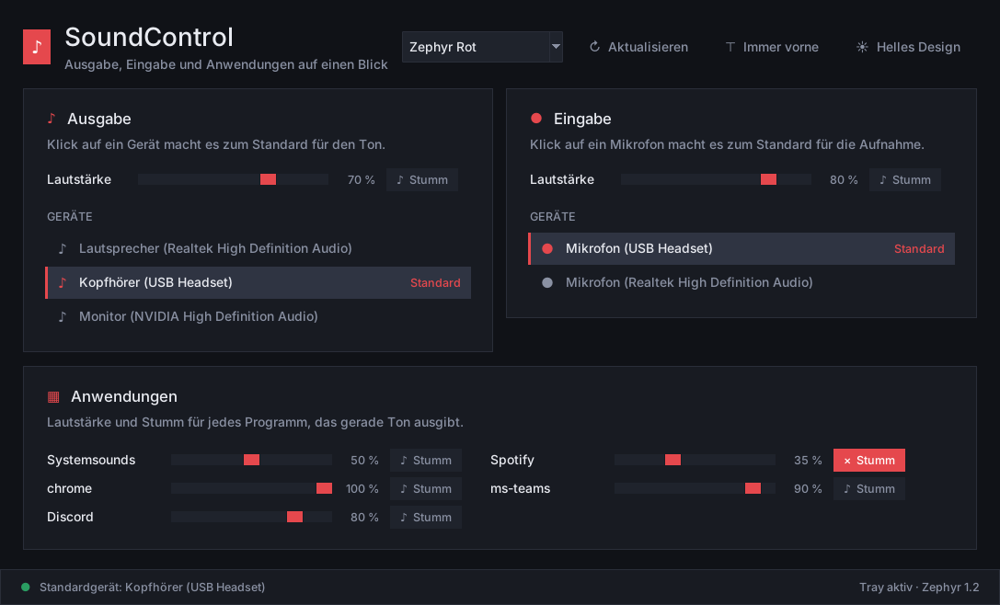
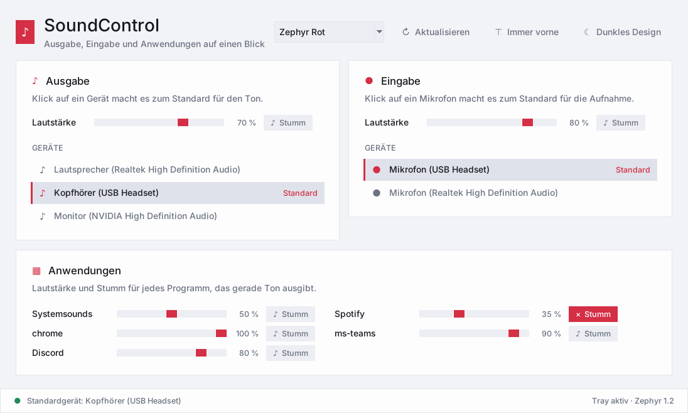

# SoundControl

Einfache Soundsteuerung für Windows – alles in **einem Fenster**, ohne Scrollen:

- **Ausgabe**: alle aktiven Lautsprecher/Kopfhörer werden als Liste angezeigt.
  Ein Klick auf ein Gerät macht es zum Standardgerät (grün = aktiv).
  Darüber: Lautstärke-Regler und „Stumm“ für das aktive Ausgabegerät.
- **Eingabe**: dasselbe für Mikrofone.
- **Anwendungen**: jede Anwendung, die gerade Audio nutzt, mit eigenem
  Lautstärke-Regler und „Stumm“-Häkchen (auf allen Ausgabegeräten).

Das Fenster aktualisiert sich automatisch alle 1,5 Sekunden (neue Geräte,
neu gestartete Programme, Änderungen aus dem Windows-Mixer). Regler lassen sich
auch mit dem Mausrad bedienen. Optional: „Immer im Vordergrund“.

## Design: Zephyr

Die Oberfläche nutzt die Designsprache **Zephyr** wie Zephyr Mail: Graphit mit rotem Akzent, flache Karten,
hell und dunkel (Knopf oben rechts) und die Farbpaletten aus Zephyr 1.2 (Auswahlliste oben).
Die Wahl wird unter `%LOCALAPPDATA%\SoundControl\einstellungen.json` gespeichert.
`zephyr_tk.py` muss im selben Ordner wie das Programm liegen.

| Dunkel | Hell |
|---|---|
|  |  |

## Tray-Icon (Infobereich unten rechts)

- **Linksklick** auf das Lautsprecher-Symbol: Fenster öffnen bzw. verstecken.
- **Rechtsklick**: Menü mit Ausgabegerät/Eingabegerät umschalten, „Ausgabe stumm“,
  „Mikrofon stumm“ und „Beenden“.
- **Minimieren** oder **X** schickt das Fenster in den Tray, das Programm läuft weiter.
  Ganz beenden: Rechtsklick auf das Symbol → „Beenden“.
- Mit `--minimiert` startet das Programm direkt im Tray (praktisch für den Autostart).

## Starten

1. Python 3.8+ für Windows installieren (Haken bei „Add Python to PATH“ setzen).
2. `requirements.bat` doppelklicken (installiert alle benötigten Pakete).
3. `start.bat` doppelklicken (oder `python soundcontrol.py`).

## EXE erzeugen

`build_exe.bat` doppelklicken. Danach liegt die fertige Datei unter
`dist\SoundControl.exe` – diese läuft auch auf PCs ohne Python.

## Hinweise

- Das Umschalten des Standardgeräts nutzt die Windows-Schnittstelle
  `IPolicyConfig` und setzt das Gerät für alle Rollen (Standard, Multimedia,
  Kommunikation).
- Anwendungen werden nach Programmname zusammengefasst (z. B. alle
  Chrome-Tabs = ein Regler).
- `python soundcontrol.py --demo` zeigt die Oberfläche mit Beispieldaten
  (funktioniert auch ohne Windows).
